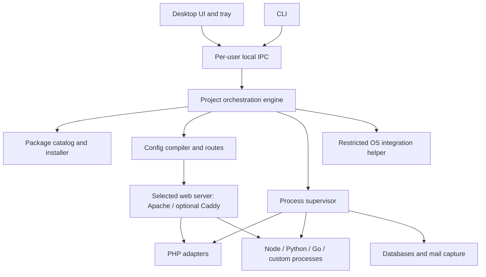

# Cross-platform local development environment: product and architecture proposal

Research date: 31 October 2026. Status: proposal; no application implementation yet.

Implementation entry point: [DEVELOPMENT_PLAN.md](DEVELOPMENT_PLAN.md) now defines the current personal-release scope, ordered stages, and acceptance gates. It supersedes this document's older release ordering and estimates. See [PACKAGE_VERIFICATION.md](PACKAGE_VERIFICATION.md) for checked sources and unresolved platform/package evidence.

Confirmed addition: language-tool and project dependency management, plus downloadable PHP extensions such as memcached. See [DEPENDENCY_MANAGEMENT.md](DEPENDENCY_MANAGEMENT.md) for scope, native compatibility, service/client distinctions, and acceptance requirements.

Confirmed planning baseline: personal development first, public release later. The user's initial workload is Next.js, Flask, FastAPI, Node.js servers, Apache, MySQL, PostgreSQL, and SQLite. The macOS test machine is a MacBook with M1 Pro, 16 GB RAM, and macOS 14.5, available for testing. See [the plan review](PRODUCT_PLAN_REVIEW.md) for proposed release sequencing; the broader feature catalog below remains a product roadmap rather than a private-alpha commitment.

The intended product is a general multi-language desktop development environment for Windows 10 and macOS. PHP compatibility matters because Laragon is the starting point, but the core model must also support Node.js, Python, Go, background workers, and combinations of those services.

## Recommendation

Build an open-source, native-first project and service manager with a shared CLI and desktop interface. Each component can use an existing installation or an app-managed download. Use real web servers, language runtimes, and databases. Apache is a first-class initial server and the default for PHP projects needing .htaccess; Caddy is an optional alternative. The application owns configuration and lifecycle only within the scope selected by the user, alongside routing, logs, and project portability.

The product promise should be: open a project, obtain the required runtimes, start its services, and get a working local HTTPS URL on either operating system. Local operation requires no account or license activation. Cached environments work offline; first installation and dependency downloads normally require connectivity.

A useful market position is the combination of Laragon's convenience, a language-neutral project model, and reproducible configuration. This is a proposed positioning, not a claim that competitors lack every individual feature.

Native operation is the initial execution backend. Design an interface for a future container backend, but do not implement two engines simultaneously. A native runtime and a Linux container are not behaviorally identical, even when their version numbers match.

## What Laragon provides

Laragon describes a portable development environment with its own asynchronous process orchestration rather than Windows services. It exposes project URLs, local HTTPS, application creation, component installation, sharing, version switching, mail capture, and terminal integration. These workflows are the baseline to preserve. See [Laragon's documentation](https://laragon.org/docs).

| Area | User value | Requirement for the new application |
| --- | --- | --- |
| Start/stop controls | A working stack without manual commands | Individual and project-wide lifecycle controls; dependency ordering; health checks |
| Pretty local URLs | Stable addresses rather than changing ports | Route hostnames to project services; support aliases |
| Local HTTPS | Secure-context and callback testing | Generate certificates, explain trust status, support trust removal |
| Runtime versions | Work on applications with different dependencies | Pin versions per project and run different versions concurrently |
| Quick application creation | Start common projects quickly | Versioned recipes for application setup and import |
| Component installation | Avoid finding and configuring packages manually | Verified package catalog with platform and architecture metadata |
| Terminal and tools | Commands use the right environment | Project shell and CLI execution with the same runtime as the server |
| Mail capture | Inspect development email safely | Mailpit integration with per-project attribution where possible |
| Configuration access | Handle uncommon application needs | Generated defaults plus persistent user overrides |
| Portable setup | Move work with little reconfiguration | Portable project manifest, lockfile, source files, and logical database exports |
| Sharing | Test callbacks and demonstrate work | Optional tunnel provider integration after the initial release |

Laragon's current policy allows unlicensed non-commercial use with reminders; commercial use has separate paid licensing. This distinction explains why avoiding popups alone is a narrower requirement than providing unrestricted local use. See [Laragon pricing](https://laragon.org/pricing).

## Competitors and features worth studying

Platform labels below identify product families, not a guarantee that every current version supports every Windows 10 build or Mac. Features and commercial tiers can differ between platforms.

| Alternative | Platforms / approach | Distinctive strengths to study | Implication for this project |
| --- | --- | --- | --- |
| Laravel Herd | Windows, macOS; native | PHP/Laravel onboarding, per-site settings, integrated debugging and managed services; free core and paid Pro | Benchmark everyday PHP convenience; distinguish our product through broad language support and an open local core |
| ServBay | Windows, macOS; managed native packages | Broad language/database catalog, routing, local DNS, certificates, and current agent integrations | Closest broad desktop competitor; cross-platform multi-language support by itself is insufficient differentiation |
| DDEV | Windows, macOS, Linux; containers | Versioned project environments, add-ons, CMS integrations, router/HTTPS, hosting integrations, file synchronization | Benchmark team reproducibility; consider integration if Linux parity becomes the main requirement |
| Lando | Windows, macOS, Linux; containers | Recipes, configurable tooling commands, lifecycle automation, Compose customization | Adopt the idea of declarative recipes and project commands |
| Local | Windows, macOS, Linux; WordPress-focused | Site blueprints, cloning, one-click admin, Live Links, host push/pull, integrated mail capture | Benchmark complete project workflows rather than just server toggles |
| MAMP / MAMP PRO | Windows, macOS; packaged native stack | GUI site management; Pro snapshots and advanced configuration; cloud project/database transfer | Study snapshot/restore UX; verify platform-specific parity rather than assuming it |
| XAMPP | Windows, macOS, Linux downloads; bundled stack | Familiar Apache/PHP/MariaDB installation and simple control panel | Useful baseline for legacy PHP compatibility; check runtime freshness independently |
| Open Server Panel | Windows; portable stack | Extensive server/database/tool catalog and configurable environment | Study breadth and power-user controls; it does not satisfy the macOS requirement |
| UwAmp | Windows; portable stack | Folder-based distribution, version switching, local sites and PHP settings | Study low-friction installation and removal; it does not satisfy the macOS requirement |

Evidence for these comparisons: [Herd](https://herd.laravel.com/windows), [ServBay package and workflow overview](https://www.servbay.com/), [ServBay platform requirements](https://support.servbay.com/getting-started/system-requirements), [DDEV features](https://ddev.com/), [Lando's project model](https://docs.lando.dev/getting-started), [Local features](https://localwp.com/features/), [MAMP feature matrix](https://www.mamp.info/en/comparison-matrix/), [MAMP Cloud](https://www.mamp.info/en/mamp-cloud/), [XAMPP downloads](https://www.apachefriends.org/download.html), [Open Server Panel repository](https://github.com/OSPanel/OpenServerPanel), and [UwAmp](https://www.uwamp.com/en/).

These are documented capabilities, not results of hands-on performance testing. Avoid using vendor speed claims as benchmarks. DDEV's file-sync approach, for example, makes simplistic claims that native is always faster inappropriate.

## Initial product scope

### Core workflows

1. Import an existing folder or create a project from a recipe.
2. Show detected runtimes, processes, databases, and requested setup steps before applying them.
3. For each component, choose a detected installation, browse to an existing installation, or download a selected version into application-managed storage. Validate the choice before starting it.
4. Start dependencies, wait for readiness, start application processes, and publish routes.
5. Open the project URL, editor, project shell, logs, mail viewer, and database tool.
6. Stop or restart a process or the whole project without affecting unrelated projects.
7. Export project configuration and logical database backups; restore on the other platform.

### First general release

| Capability | Scope |
| --- | --- |
| Project model | Several named services, commands, environment variables, routes, health checks, dependencies, and persistent storage per project |
| Runtimes | PHP, Node.js, Python, Go; deliberately limited tested version catalog |
| Component sources | Existing local installations and app-managed downloads; independent selection per runtime or service |
| Recipes | Generic PHP, Laravel, WordPress, Node HTTP/Vite, Python ASGI, Go HTTP; generic command recipe for other stacks |
| Databases | Start with one managed engine during the prototype; target MariaDB and PostgreSQL for the general beta; recognize project-owned SQLite |
| Web routing | Apache with native .htaccess support, local HTTPS, reverse proxy, PHP FastCGI, static files, WebSocket support; optional Caddy backend |
| Process control | Readiness states, bounded restart policies, clean shutdown, process-tree cleanup, crash reporting |
| Daily interface | Project list, service health, runtime selection, logs, tray/menu bar controls, settings, CLI |
| Developer tools | Composer integration, Node package-manager commands, uv/virtual environments, Go commands, Mailpit, Xdebug setup |
| Data safety | Database import/export; backups before upgrades; separate immutable packages and mutable data |
| Sharing setup | Human-readable manifest plus platform-aware lockfile; local secrets excluded |
| Migration | Import Laragon project paths, document roots, and supported settings; import SQL dumps rather than database directories |

Node package managers and Python/Go dependency tools remain responsible for their own dependency lockfiles. The app lockfile records runtime/service artifacts and recipe versions; it must not pretend to replace npm, Composer, uv, or Go dependency resolution.

Support project processes from day one so that Java, .NET, Ruby, and other tools can be used through explicitly configured executables. Full managed installation and first-class recipes for those ecosystems come later. A generic command entry is useful support, but should not be marketed as full runtime management.

### Later releases

- Redis-compatible service choices, search engines, object-storage emulators, and message brokers.
- Additional web-server providers such as nginx; Apache is included in the initial scope.
- Tunnel providers, LAN/mobile testing, webhook inspection, and configurable authentication.
- Branch workspaces with separate database instances or clones.
- Runtime test matrices and CI configuration export.
- Optional container execution through an existing provider.
- Additional managed runtimes and a curated extension catalog.
- An opt-in local automation API, after stable CLI permissions and behavior exist.

Leave Kubernetes management, a general database IDE, an editor replacement, production hosting, and a custom cloud synchronization service outside the initial scope.

## Execution backend decision

| Approach | Advantages | Costs | Recommendation |
| --- | --- | --- | --- |
| Native services | No required VM; direct project filesystem access; matches Laragon workflow | Package each OS/architecture; handle OS differences and extension availability | Initial backend |
| Existing container provider | Linux-oriented reproducibility; broad service/image ecosystem | Provider setup, virtualization, filesystem/network behavior, provider support policy | Optional later backend |
| Both immediately | Broad theoretical coverage | Two lifecycle, network, storage, and support implementations before product validation | Defer |

Windows 10 general support ended on 14 October 2025. Docker's current Windows instructions still list specific Windows 10 configurations while also conditioning support on Microsoft's servicing timeline. Therefore Windows 10 container compatibility needs explicit validation and must not be assumed from a general Windows support label. See [Microsoft's lifecycle announcement](https://learn.microsoft.com/en-us/lifecycle/announcements/windows-10-end-of-support) and [Docker's Windows requirements](https://docs.docker.com/desktop/setup/install/windows-install/).

Initial validation targets: the user's Windows 10 machine (exact build/architecture to inspect before implementation) and their MacBook M1 Pro, 16 GB RAM, running macOS 14.5. The Mac is available for testing. Target native macOS arm64 artifacts; any emulation requirement must be an explicit exception. These are test targets, not demonstrated compatibility. Validate the desktop shell and every selected runtime/service package against macOS 14.5. Windows 11, Intel Macs, other macOS versions, and Linux are possible later support targets rather than initial compatibility promises.

## Proposed implementation

### Technology choice

- Desktop shell: Tauri 2.
- UI: React and TypeScript; conventional accessible components.
- Core and CLI: Rust, sharing project, package, and orchestration libraries.
- Concurrency: Tokio for process I/O, health checks, downloads, and event delivery.
- Local application state: SQLite for the project index, settings, install records, and local allocations.
- Project configuration: versioned TOML schema and a generated lockfile.
- Web-server layer: Apache initially; optional Caddy provider. Local certificate management is independent of the selected web server.
- IPC: user-restricted named pipe on Windows and Unix socket on macOS.

This is an engineering recommendation. Tauri uses WebView2 on Windows and the OS webview on macOS; it avoids bundling an entire browser engine but requires testing against both rendering environments. Its installer can provision WebView2. See [Tauri prerequisites](https://v2.tauri.app/start/prerequisites/) and [Windows installer documentation](https://tauri.app/distribute/windows-installer/).

Electron is a reasonable alternative if a JavaScript-only team and consistent Chromium rendering outweigh package/runtime overhead. Go with Wails is another candidate if the team already knows Go well. Framework familiarity can outweigh small shell differences; package maintenance and service behavior are the larger risks.

### Components

One per-user engine should own service state so the desktop and CLI cannot accidentally start duplicate stacks. Initially this can be an engine process launched on demand; do not require a machine-wide daemon. Closing the main window leaves the tray and running work available. Exiting the engine performs an orderly stop unless an explicit background mode is selected.

The helper handles narrowly defined privileged operations such as certificate trust or hostname integration when needed. It must not accept arbitrary shell commands, project scripts, or unrestricted filesystem writes. Regular application processes run as the current user.

### Service and runtime model

Use a service state machine: absent, installing, stopped, starting, healthy, unhealthy, stopping, failed. Track desired state separately from observed state. A running process is not necessarily a ready database or HTTP server.

Start in dependency order, wait for actual readiness, and stop in reverse order. Share services only when explicitly modeled; track project ownership so stopping one project does not kill a database still in use. A project needing strong data separation receives its own database instance and data directory.

On Windows, manage process trees using Job Objects where suitable and provide graceful shutdown strategies for database servers and console applications. On macOS, use process groups and appropriate signals. Record ownership and process identity to avoid confusing reused PIDs with managed services. Validate recovery after app crashes, sleep/wake, and interrupted installs.

PHP needs different runtime integration on each platform: PHP-FPM on macOS and supervised PHP CGI/FastCGI processes on Windows. Use compatible non-thread-safe Windows builds and matching extensions for FastCGI. Apache routes PHP requests to the selected backend; a future mod_php mode would need its own build-compatibility validation. PHP documents Windows build types, runtime dependencies, and extension constraints in its [Windows installation guide](https://www.php.net/manual/en/install.windows.manual.php). The optional Caddy provider can also proxy PHP FastCGI backends; see [its PHP directive](https://caddyserver.com/docs/caddyfile/directives/php_fastcgi).

Apache itself interprets .htaccess; no translation or emulation layer is needed. The Apache provider installs or locates httpd, generates virtual-host configuration, enables required modules such as mod_rewrite, configures AllowOverride/AllowOverrideList for the selected project directory, connects PHP, and validates configuration before reload. Imported PHP projects using .htaccess should default to Apache. Existing module, path, and PHP-handler requirements still need validation. See [Apache's .htaccess documentation](https://httpd.apache.org/docs/2.4/howto/htaccess.html).

Here, a provider or adapter means application code for discovering, installing, configuring, starting, stopping, and inspecting the actual server. It does not implement the server's configuration language. If a user explicitly chooses Caddy or nginx, Apache .htaccess processing is unavailable; suggest Apache for that project instead of promising automatic rule conversion. Running Apache does not require running Caddy in front of it.

Node, Python, and Go services are ordinary supervised processes behind the router. Launch via executable and argument arrays with explicit working directories and environment; invoke a shell only for commands that explicitly require one. Python gets a project virtual environment. uv provides managed Python distributions for Windows and macOS through python-build-standalone; reuse that capability rather than inventing Python distribution. See [uv's Python version documentation](https://docs.astral.sh/uv/concepts/python-versions/).

### Existing installations and managed downloads

Every supported component has a source selection:

| Source | Application behavior | Update ownership |
| --- | --- | --- |
| Existing installation | Discover candidates or accept a user-selected executable/install root; validate version, architecture, capabilities, and dependencies; bind explicitly per project | Report available compatible releases; leave installation updates to its owner/package manager unless an explicit supported integration is selected |
| App-managed download | Resolve a catalog entry, download and verify artifacts, install into private versioned storage, configure, launch, and track projects using it | Offer installation of newer compatible versions side by side and an explicit project switch |
| Existing running service | Connect to a database or other service through an endpoint and credentials; check connection/readiness | Connection-only by default; no assumed authority to restart, upgrade, or uninstall it |

The choice is independent per component: a project can use external Python 3.12, downloaded Apache and PHP, and an already running PostgreSQL server. Reusing an executable and attaching to a running server are separate operations. A local database client executable alone does not identify a manageable database server installation.

Discover candidates through relevant PATH entries, platform registries, standard install locations, and supported package-manager integrations; provide a Browse option. Show actual resolved paths, detected versions, architecture, and source. Probe selected candidates without installing dependencies or changing their global configuration. Python virtual environments are supported, but distinguish an existing environment from a base interpreter used to create a project environment. uv's [managed/system Python model](https://docs.astral.sh/uv/concepts/python-versions/) demonstrates this distinction for Python.

After selection, save an explicit local binding rather than relying on whichever executable PATH finds on the next launch. Revalidate bindings and report moved, removed, or externally changed installations. Keep machine-specific paths in local state; the shared project manifest records runtime requirements. An external runtime cannot promise an immutable pinned artifact, so record and expose that limitation.

Where supported, launch external binaries with app-owned configuration, working directories, ports, and data directories. External installations may be non-relocatable or impose configuration constraints; validate support rather than assuming any executable can be adopted. Do not overwrite global configuration, remove external installations, or stop existing system services as an implicit consequence of project start/stop.

### Packages and updates

Maintain a small signed catalog. Each entry includes component/version, OS/architecture, minimum OS, artifact URL, checksum, signature/provenance where available, dependencies, license metadata, executable paths, configuration adapter, and health-check strategy.

Download into temporary storage, verify, extract safely, test, and atomically activate. Packages are immutable and may coexist. Keep project configuration, database files, backups, cache, logs, and credentials outside package directories. Update application binaries separately from service packages.

Expose a component catalog showing available versions, supported platforms, installation source, installed versions, project usage, and update status. Check for catalog updates in the background when enabled, with manual refresh and offline cached operation. Distinguish an upstream release being announced from a verified package being ready for installation. Some releases require building, extension matching, and compatibility testing before publication in our catalog.

Default update workflow: notify, download/install side by side, validate, then let the user choose which projects switch. Preserve project pins and avoid replacing active executables. Optional automatic download or patch-update policies can be added with an explicit restart policy. Existing installations receive informational updates or a supported owner/package-manager action; switching to an app-managed replacement is a separate user choice. Database upgrades use engine-specific migration workflows rather than the generic runtime switch.

Prefer upstream redistributable artifacts when suitable. PHP on macOS and extension compatibility require an explicit package supply strategy: validate an existing suitable distribution, or own a reproducible build and release pipeline. A Homebrew adapter is useful during prototyping but is not a guarantee of a portable, self-contained installation.

Apache also needs a binary distribution strategy. The Apache project distributes source releases rather than official Windows binaries and lists third-party binary distributors. Validate a trusted distribution or provide our own reproducible builds for supported targets. The provider must download and install runnable packages for users rather than requiring them to compile Apache. See [Apache's Windows distribution notes](https://httpd.apache.org/docs/2.4/platform/windows.html).

Never point a new database major version at an existing data directory as a generic version switch. Use engine-supported migration/export/restore procedures and validate the result. Rollback requires compatible data or a backup, not just restoring the old executable.

Do not assume a Redis executable has the same native support story on both platforms. Redis documents Windows through Memurai or WSL. Keep it out of native parity promises until an appropriate provider and its distribution terms are selected. See [Redis Windows installation](https://redis.io/docs/latest/operate/oss_and_stack/install/archive/install-redis/install-redis-on-windows/).

### Domains, HTTPS, configuration, and portability

Default to project.localhost after resolver/browser testing. Support project.test through explicit host entries initially; wildcard DNS is a later OS integration feature. A wildcard entry cannot simply be written into the hosts file. Avoid .local because of its mDNS role. The relevant namespace behavior is specified in [RFC 6761](https://www.rfc-editor.org/rfc/rfc6761) and [RFC 6762](https://www.rfc-editor.org/rfc/rfc6762).

Use one local CA per installation, with protected private-key storage, implemented through a mature certificate tool/library selected during the feasibility slice. Trust installation/removal is explicit. Never move the CA private key between machines in project exports. Browser and language trust stores can differ, so report trust problems separately from server health. Provide generated certificate/key paths to Apache's TLS configuration. The optional Caddy provider also supplies local certificate authority functionality, but Apache users must not depend on running Caddy. See [Caddy's HTTPS documentation](https://caddyserver.com/docs/automatic-https).

Handle occupied HTTP/HTTPS ports visibly. Offer an alternate high port when necessary; do not terminate unrelated processes. Supporting tidy 80/443 URLs can require OS-specific setup, especially privileged port binding on macOS.

Keep manifest paths relative. A platform-aware lockfile maps runtime versions to the appropriate OS/architecture artifacts; pin recipe versions and environment-relevant settings too. Reuse a package cache by artifact identity. A lockfile does not erase filesystem case, Unix extension, native dependency, or Windows process differences.

Protect local credentials through OS facilities such as Credential Manager and Keychain; inject them at launch and redact diagnostic exports. Bind managed admin interfaces and services to loopback by default. Imported setup hooks and recipes need a clear execution preview and trust model. Native process isolation separates configuration and data; it is not a security sandbox.

Cross-platform movement means source, manifests, dependency lockfiles, and logical database backups. Reinstall binaries and rebuild native dependencies on the destination. Do not sync live database files, Python virtual environments, node_modules with native extensions, or executable packages between operating systems.

## Features that could make this product preferable

These are hypotheses to validate with users, rather than claims of exclusive invention:

1. **Explain and repair failures.** A diagnostic command and UI connect unhealthy services to port owners, missing runtimes, invalid configuration, failed certificate trust, or application errors. Suggested fixes state their exact effect.
2. **Mixed-language projects as the default.** A single project can include a Node frontend, Python API, PHP admin, Go worker, and databases, each with independent logs and routing.
3. **Predictable Windows-to-Mac handoff.** Export an environment report, validate package availability, and identify portability problems before the move.
4. **Concurrent runtime versions.** Two projects use different versions at once, with shell and server versions kept consistent.
5. **Safe environment experimentation.** Clone configuration and logical databases into a new workspace before a runtime upgrade; retain a verified recovery path.
6. **Open and offline local operation.** No activation dependency for the core; optional paid support or hosted services can fund maintenance without gating local server startup.

For the initial release, prioritize diagnostics, mixed-language workflows, concurrent versions, and reliable project configuration. Branch databases and automated runtime matrices are later extensions.

## Build sequence and validation

### Milestone 1: feasibility slice

On Windows 10 and a Mac, launch one Node service and one Python service behind Apache, expose local HTTPS, capture logs, and stop all descendants cleanly. Exercise both a detected existing runtime and an app-managed download. Validate a PHP project whose .htaccess rewrite rules are processed by Apache, PHP packaging, and a database upgrade/restore path before committing to release scope. No elaborate GUI is needed for this spike.

Exit criteria: reliable restart, occupied-port handling, paths with spaces and non-ASCII characters, browser trust verification, and no orphan processes. Validate native arm64 and x64 packaging rather than relying exclusively on emulation.

### Milestone 2: usable core

Implement the manifest and lockfile, external-installation discovery and local bindings, package catalog and installation, update notifications, lifecycle state machine, dependency graph, CLI, project shell, Apache routing, and a first managed database. Add integration tests using real processes and a sample mixed-language project.

### Milestone 3: personal-use alpha

Add the desktop/tray interface, PHP/Node/Python/Go recipes, runtime switching, Mailpit, basic diagnostics, and database export/restore. Import an existing Laragon project without changing its original database data directory.

### Milestone 4: general beta

Add the second database engine, signed installers/updates, macOS signing and notarization, catalog provenance and license notices, a tested support matrix, upgrade/recovery tests, and documentation. Test on actual Windows 10 and macOS machines; a Windows 11 build runner does not demonstrate Windows 10 compatibility.

Useful acceptance scenarios:

- Two projects run concurrently with different PHP/Node/Python runtime versions.
- A project mixes an existing Python installation with downloaded components without modifying the external installation.
- A moved or externally upgraded runtime is detected and produces an actionable binding/compatibility message.
- A new runtime package installs alongside an old one; existing projects retain their selected version until switched.
- Apache processes the sample project's .htaccess rewrites with the required modules and directory overrides enabled.
- A connection-only external database remains running and unchanged when the project stops or is removed.
- A frontend, API, database, and worker start in the right order and expose healthy routes.
- WebSocket traffic and file uploads work through HTTPS.
- A failed configuration update retains the last working configuration.
- Stopping one project leaves another project's services intact.
- A database survives orderly shutdown, application crash recovery, and an upgrade rehearsal.
- Export from Windows and restore on macOS passes the sample app's tests.
- Cached projects start offline; unavailable downloads produce an actionable error.
- Uninstall can remove integration while preserving projects and database data by default.

Set performance budgets after measuring the feasibility build. Report UI/engine overhead separately from the memory used by databases and applications. Compare identical sample workloads against relevant competitors rather than repeating marketing numbers.

Rough planning estimate, not a commitment: a focused feasibility slice may take 2–4 weeks; a useful private alpha may take another 6–12 weeks; a maintainable general beta with four managed runtimes, both target systems, and release infrastructure is a several-month effort, roughly 4–8 months for one experienced full-time developer. Experience, existing package sources, and extension requirements can move this substantially. Broader Laragon parity plus containers, many services, and reliable team workflows can extend beyond a year.

## Sustainability and next concrete deliverable

Choose an OSI-approved license for the original application, such as Apache-2.0 or MIT, and maintain a separate inventory of third-party package terms and notices. The application's license does not change licenses of runtimes, databases, or bundled tools. Budget for runtime updates, package CI/storage, signing/notarization, testing hardware, and vulnerability response as continuing product work.

Before building the full interface, deliver the feasibility slice and a recorded compatibility matrix. The first meaningful demonstration is the same mixed-language project running through the same CLI workflow on Windows 10 and macOS, with trustworthy HTTPS, useful failure messages, and clean shutdown.
